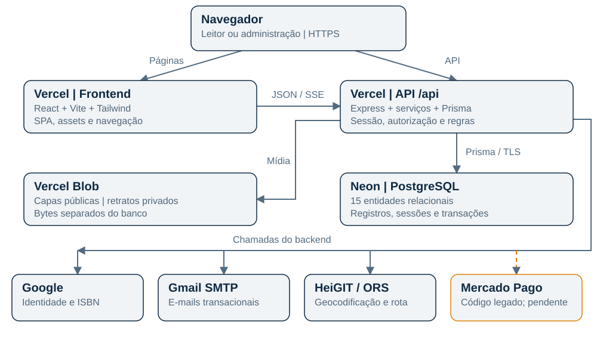
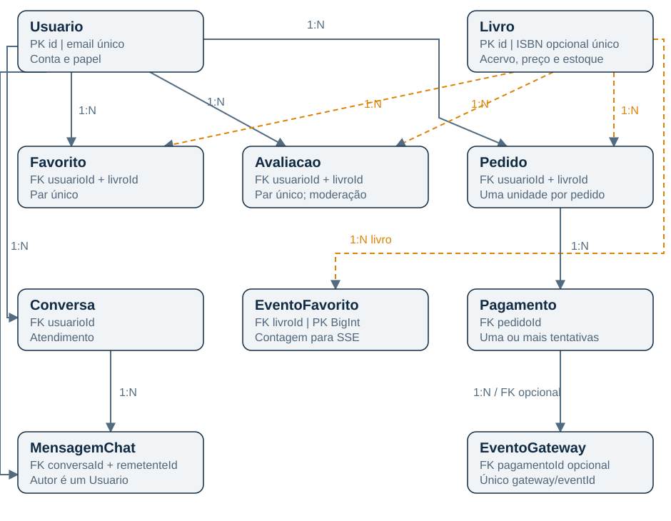
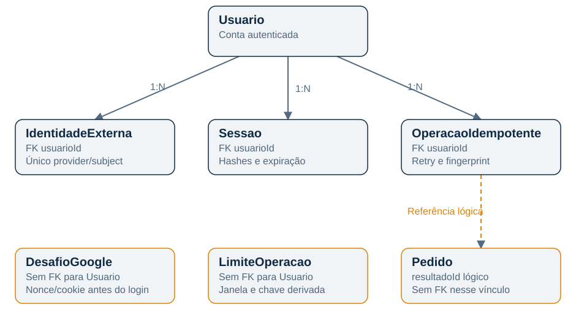

# BiblioConnect | Documentação técnica

Arquitetura, infraestrutura, funcionalidades, banco de dados e operação.

**Edição:** 15 de outubro de 2026. **Aplicação:** https://biblioconnect-olive.vercel.app.

Este documento descreve o código e as verificações disponíveis nesta edição. Decisões históricas podem ter mudado; prevalecem o código atual e a evidência mais recente. Não inclui credenciais, tokens ou conexões privadas do banco.

## 1. Visão geral e estado do projeto

O BiblioConnect centraliza descoberta de livros, circulação e operação de uma biblioteca. O leitor consulta o acervo, salva livros, reserva, compra ou aluga, acompanha seus pedidos e conversa com a equipe. A administração mantém catálogo, estoque, entregas, usuários, avaliações e informações financeiras.

O catálogo publicado foi conferido com **131 livros**. É uma contagem de referência, não uma constante do sistema. O projeto tem caráter acadêmico e preparação de produto; uma tela funcional ou uma variável configurada não equivale à homologação comercial.

| Perfil | Acesso |
| --- | --- |
| Visitante | Home, catálogo, avaliações públicas, cadastro e login |
| CLIENTE | Perfil, favoritos, checkout, seus pedidos, avaliações elegíveis e atendimento |
| ADMIN | Painel, acervo, pedidos de clientes, financeiro, entregas, atrasos, usuários e moderação |

As proteções React organizam a navegação; a autorização efetiva é verificada no servidor. Contas bloqueadas não têm acesso normal. O administrador pessoal foi preservado; um administrador compartilhado da equipe foi provisionado separadamente e testado com três sessões simultâneas. Nenhuma credencial administrativa integra esta documentação.

### 1.1 Estado das integrações

| Componente | Evidência e limite |
| --- | --- |
| Vercel e Neon | Aplicação publicada, catálogo consultado e painel autenticado verificado |
| Google | Login real administrativo concluído em produção |
| Gmail SMTP | Autenticação, envio e recebimento de teste real confirmados |
| Fotos | Privadas; fallback de imagem coberto por automação, sem teste em iPhone físico |
| ORS/HeiGIT | Configurado; cotação real já verificada localmente, sem nova compra de produção |
| Mercado Pago | Adaptador e webhook presentes; cobrança real não homologada |
| Stripe | Planejado e listado na configuração, mas fluxo executável não migrado |
| Cron | Agendado na configuração; disparo automático na plataforma ainda requer logs |

## 2. Arquitetura



O sistema é composto por uma SPA React e uma API Express. O backend é um monólito modular: mantém rotas históricas em `server.js` e módulos especializados em `src/routes` e `src/services`. Os dois serviços de publicação da Vercel não constituem uma arquitetura de microsserviços de domínio.

| Camada | Responsabilidade | Código |
| --- | --- | --- |
| Interface | Telas, formulários, temas e movimentos | frontend/src/pages, components e features |
| Navegação | Rotas públicas, cliente e administração | frontend/src/routes.js e AppRoutes.jsx |
| Comunicação | Sessão do navegador, requisições e CSRF | frontend/src/context e api/api.js |
| Entrada HTTP | Parsing, CORS, montagem e filtros | server.js e src/app.js |
| Domínio | Pedidos, estoque, perfil, favoritos e tokens | src/services |
| Persistência | ORM e transações | Prisma + PostgreSQL |
| Integrações | Identidade, e-mail, rotas e mídia | Adaptadores específicos |

### 2.1 Caminho de uma requisição

1. O navegador recebe o frontend Vite. React Router carrega páginas sob demanda.
2. Axios envia a chamada com cookie de sessão e, nas alterações autenticadas, token CSRF.
3. Na hospedagem, `/api` vai ao serviço backend. `src/app.js` monta Express nesse prefixo.
4. A API valida sessão, autorização, origem e os dados aplicáveis.
5. Os serviços executam as regras; mudanças críticas de estoque usam transações.
6. Prisma acessa o Neon. Storage e provedores externos usam seus adaptadores.
7. A resposta atualiza a tela. Contadores de favoritos também recebem eventos SSE.

### 2.2 Ambientes

| Aspecto | Local | Publicado |
| --- | --- | --- |
| Frontend | Vite em localhost:5173 | Build estático na Vercel |
| API | Node em localhost:3000 | Express executado pela Vercel |
| Prefixo da API | Rotas na raiz | /api |
| Banco | PostgreSQL próprio ou PGlite isolado | PostgreSQL Neon |
| Mídia | Disco conforme configuração | Blob público e privado |
| E-mail | Pode ser arquivo em desenvolvimento | Gmail SMTP |
| Rotinas | Timers locais habilitáveis | Endpoint protegido chamado por cron |

A demonstração não sincroniza dados automaticamente com a produção. Não abrir diretamente um diretório PGlite vivo por um segundo processo. O disco temporário de uma Function não substitui banco ou storage persistente.

## 3. Tecnologias utilizadas

### 3.1 Frontend e design

React 19 organiza componentes e páginas; Vite 8 gera o build; React Router 7 controla navegação e carregamento por `lazy`/`Suspense`. Tailwind CSS 4 fornece utilitários, complementados por CSS próprio de componentes. A migração não eliminou todo CSS manual. Axios centraliza a API.

Recharts desenha gráficos, Lucide fornece ícones, e GSAP/Three.js/React Three Fiber sustentam movimento e recursos 3D. Source Serif 4 e IBM Plex Sans são fontes locais via Fontsource. A identidade utiliza azul, laranja e composição editorial contemporânea.

Uiverse, React Bits, 21st.dev, Magic UI, Ruixen UI, shadcn/ui e Tremor foram fontes de referência ou de componentes adaptados, conforme `THIRD_PARTY_NOTICES.md`. Não são todos dependências instaladas. Referência visual não significa importação integral; o projeto não declara incorporação de código pago do React Bits Pro.

### 3.2 Backend e ferramentas

Express 5 em Node.js fornece a API; Prisma 5.22 modela PostgreSQL e transações. bcryptjs verifica hashes de senha; Google Auth Library valida tokens Google; Nodemailer 10.1.1 envia e-mails; Multer controla upload e Sharp processa imagens.

A dependência `jsonwebtoken` é legada: o login atual usa sessões persistidas e tokens opacos. Recursos MediaPipe antigos permanecem nos arquivos, mas o editor atual não os executa. Versões exatas estão nos lockfiles; os manifestos podem conter intervalos de versão.

Node Test Runner, Vitest, Testing Library, Playwright e ESLint cobrem serviços, componentes, navegação e qualidade. PGlite permite QA isolado. Git mantém código e migrações. CodeGraph apoia navegação estrutural durante desenvolvimento; não executa no site publicado.

## 4. Funcionalidades do leitor

### 4.1 Descoberta, catálogo e Atlas

A home apresenta capas reais do acervo em um hero animado, destaques e rankings. O catálogo reúne busca, filtros e Atlas, uma exploração dos livros como constelação. O Atlas utiliza dados da API; não é um recomendador por IA. O catálogo mantém os títulos clássicos junto aos demais gêneros.

Cards exibem dados, disponibilidade e ações conforme o contexto. A equipe controla destaque, publicação, estoque e capas. Consulta por ISBN auxilia o cadastro por Google Books; metadados retornados precisam de revisão. As capas continuam sujeitas aos direitos de seus titulares.

### 4.2 Cadastro, Google e apresentação

O cadastro com senha cria CLIENTE, emite confirmação e mantém o login bloqueado até o link ser consumido. Se o e-mail falhar depois de criar a conta, a interface evita nova submissão e mantém o reenvio. Recuperação usa token com validade e uso único.

O login Google valida assinatura, emissor, audience, expiração, nonce e e-mail verificado. Identidade nova pode criar um CLIENTE. Gmail ou identidade com domínio Google autoritativo pode dispensar confirmação local. Colisões com conta existente exigem vínculo autenticado; informar um endereço não promove alguém a ADMIN.

A apresentação inicial utiliza `Usuario.welcomeSeenAt`, com reivindicação atômica. Depois de consumida, não se repete por dispositivo/visita apenas por limpar o armazenamento do navegador.

### 4.3 Perfil e foto

O perfil reúne nome, contato, endereço, livros salvos e carteirinha animada inspirada no Lanyard. A foto mantém fundo e imagem inteira. O editor recebe JPG, PNG e WebP de até 5 MB na seleção e prepara upload menor. Há fallback PNG/JPEG quando o navegador não consegue codificar WebP.

A API aceita um arquivo processado de até 2 MB. Sharp valida bytes reais, limita processamento, remove metadados e gera WebP. O banco armazena `avatarKey`; os bytes ficam privados no storage. A foto é entregue por rota autenticada, com cache privado/no-store. Não há remoção de fundo ativa nem envio da foto ao Google para esse fim.

### 4.4 Favoritos e avaliações

Cada usuário salva um livro uma única vez, garantido por chave composta. A contagem usa SSE, cursores, reconexão e resumo de recuperação. O servidor consulta eventos no banco periodicamente; não utiliza WebSocket ou broker dedicado. Limites de conexões e latência devem ser avaliados conforme o público cresce.

Avaliações recebem notas inteiras de 1 a 5 e comentários de 3 a 1.500 caracteres. Exigem pedido anterior não cancelado do livro. Há uma avaliação por usuário/livro; edição retorna à moderação. Apenas aprovadas são públicas. A equipe pode aprovar, ocultar e excluir.

### 4.5 Atendimento

Conversas e mensagens ficam persistidas. O cliente envia dúvidas e acompanha respostas humanas. O painel administrativo tem busca, filtros, prévias, balões, campo de resposta e encerramento. No celular, a conversa ocupa a área principal com retorno à lista. Não se trata de chatbot de IA.

## 5. Pedidos, estoque e entrega

### 5.1 Estrutura da circulação

Cada Pedido referencia exatamente um usuário e um livro. Não existem carrinho ou PedidoItem no schema atual. Cada pedido representa uma unidade; múltiplos títulos no mesmo carrinho exigem evolução do modelo e regras.

| Tipo | Comportamento |
| --- | --- |
| reserva | Reserva unidade disponível e define prazo de retirada |
| compra | Registra compra com retirada/entrega e total calculado no servidor |
| aluguel | Registra dias, devolução prevista, valor e possível extensão |

Criação do pedido e baixa de estoque são uma única transação. A atualização exige disponibilidade e estoque positivo, protegendo a última unidade contra concorrência. A idempotência associa usuário, escopo, chave e fingerprint ao resultado para evitar pedidos duplicados por retry.

### 5.2 Estados e regras

Compras e reservas pendentes podem ser concluídas ou canceladas. Aluguéis também permitem devolução. Conclusão/devolução exigem pagamento marcado como pago. Estados finais não reabrem pelas transições atuais. Cancelamento de pedido pago com valor positivo exige providenciar estorno primeiro.

Cancelamento/devolução devolvem estoque. Concluir reserva ou aluguel também devolve a unidade; concluir compra consome a unidade. A equipe deve finalizar aluguel apenas quando o exemplar puder voltar ao acervo. Estado do pedido, pagamento e entrega são campos separados; um selo de pago não significa que a entrega terminou.

### 5.3 Checkout por CEP

A prévia no catálogo leva ao checkout. Endereço estruturado, ViaCEP, frete e confirmação por pressionamento ficam nessa etapa. CEP preenche rua, bairro, cidade e UF; número, complemento e conferência ficam com o usuário. Alterar endereço invalida cotação anterior.

Segurar o botão cria o pedido e segue à etapa financeira. O gesto evita cliques acidentais, mas não substitui autorização do pagamento, autenticação ou transação de estoque.

### 5.4 Cálculo de frete

O backend usa openrouteservice/HeiGIT para geocodificar origem/destino e calcular rota de carro. A tarifa é `base + distância integral em km × preço por km`, arredondada ao final. A configuração de referência usa base R$ 5,00 e R$ 2,50/km, alteráveis por ambiente.

A origem informada para o campus é Rua José de Alencar, 511, Farol, Maceió. A consulta anterior encontrou a rua sem precisão do número; o sistema sinaliza aproximação. Não afirmar que é a entrada exata da faculdade. Não há trânsito ao vivo nem contratação automática de entregador.

Uma cotação anterior ao Marco dos Corais retornou 7,01 km e R$ 22,52, calculados com a distância integral. É evidência histórica, não um preço garantido. Falha, cota ou baixa confiança do provedor não geram frete fictício. Parceiros são acessados por links externos.

## 6. Pagamentos e financeiro

### 6.1 Implementação executável

`src/services/paymentService.js` ainda cria preferências do Mercado Pago Checkout Pro. A API inicia em `POST /pedidos/:id/pagamento` e recebe `POST /webhooks/mercadopago`. Não foi encontrado fluxo Stripe de Checkout/PaymentIntent ou webhook Stripe no código atual.

`STRIPE_SECRET_KEY`, `STRIPE_PUBLISHABLE_KEY` e `STRIPE_WEBHOOK_SECRET` aparecem no checklist. São preparação, não integração funcional. Migração, formulário de cartão animado e Pix pelo Stripe continuam pendentes. Não houve cobrança real homologada nesta edição.

### 6.2 Regras e limitações

O retorno do navegador não aprova pagamento. O webhook legado valida assinatura e consulta o provedor, incluindo valor, moeda, referência e tratamento idempotente. Um pedido pode ter várias tentativas ou pagamentos de extensão.

O painel financeiro calcula resumos e gráficos sobre os registros. Alterar status administrativo não executa estorno no provedor. O comprovante imprimível registra a operação; não é nota fiscal. O modelo não armazena número de cartão/CVV.

Antes de receber dinheiro, concluir o gateway escolhido, testar webhook assinado, sucesso, recusa, cancelamento, estorno e conciliação. Simulação é recusada em produção. Conferir preços e estoque físico. Valores são Float no schema; uma evolução para Decimal ou centavos inteiros precisa revisar regras e arredondamentos.

## 7. Funcionalidades administrativas

O menu organiza Painel, Acervo, Operações e Gestão, com grupos recolhíveis e versão compacta. Há métricas de circulação e gráficos administrativos, financeiro e atendimento como caixa de entrada.

| Módulo | Operações |
| --- | --- |
| Livros | Criar/editar, estoque, capa, destaque e disponibilidade |
| Pedidos | Consultar clientes e aplicar transições permitidas |
| Entregas | Endereço, situação, transportadora e rastreio |
| Atrasos | Reservas vencidas e aluguéis pendentes |
| Financeiro | Resumos e alterações administrativas de status |
| Usuários | Clientes, bloqueio/desbloqueio e remoções conforme regras |
| Avaliações | Moderação de notas e comentários |
| Atendimento | Responder, filtrar e encerrar conversas |

Há uma rota legada de reset administrativo. É destrutiva e não faz parte do deploy ou da operação cotidiana. Nunca usar reset/seed para atualizar uma instalação com dados reais sem backup e autorização específica.

## 8. Banco e relacionamentos

O datasource Prisma é PostgreSQL, hospedado no Neon em produção. O schema possui 15 modelos. Entidades de negócio usam principalmente Int autoincremental; sessões/controles usam String/cuid; EventoFavorito usa BigInt.

### 8.1 Núcleo de negócio



| Relação | Cardinalidade | Significado |
| --- | --- | --- |
| Usuario → Pedido | 1:N | Pedido pertence ao leitor |
| Livro → Pedido | 1:N | Pedido referencia um livro |
| Pedido → Pagamento | 1:N | Tentativas e pagamentos de extensão |
| Usuario + Livro → Favorito | N:N resolvido | Um salvo por par |
| Usuario + Livro → Avaliacao | N:N resolvido | Uma avaliação por par |
| Usuario → Conversa | 1:N | Conversas do leitor |
| Conversa → MensagemChat | 1:N | Histórico da conversa |
| Usuario → MensagemChat | 1:N | Autor, inclusive administrador |
| Livro → EventoFavorito | 1:N | Eventos para sincronização |
| Pagamento → EventoGateway | 1:N, opcional no evento | Deduplicação de eventos |

### 8.2 Autenticação e controles



Usuario possui várias IdentidadeExterna, Sessao e OperacaoIdempotente. IdentidadeExterna tem unicidade `(provider, subject)`. Sessao guarda hashes e datas, não o token aberto. OperacaoIdempotente combina usuário, escopo, hash de chave e fingerprint de entrada.

DesafioGoogle e LimiteOperacao não têm FK para Usuario. DesafioGoogle existe antes do login; LimiteOperacao controla janelas por chave derivada. `OperacaoIdempotente.resultadoId` é referência lógica ao pedido, sem FK declarada. `Usuario.stripeCustomerId` é um campo preparatório opcional/único, não evidência de Stripe ativo.

### 8.3 Integridade e exclusões

E-mail, ISBN preenchido, favoritos/avaliações por par, identidade externa, eventos de gateway e chaves de controle têm unicidade. Há índices por usuário, livro, conversa, estados e datas de expiração. `role`, `status`, `tipo` e `gateway` são String, não enums PostgreSQL no schema; dependem da validação da aplicação.

Relações indicadas no schema usam cascata para dependências como sessões, favoritos e mensagens. Pagamento acompanha exclusão de Pedido. EventoGateway mantém seu registro com pagamento nulo quando esse pagamento é removido. Pedido não declara cascata ao excluir Usuario/Livro; a integridade histórica depende das FKs resultantes das migrações. O anexo registra cada declaração de relação e de exclusão.

O [dicionário completo](dicionario-de-dados.md), incluído no PDF, lista todos os campos escalares, tipos, defaults, índices e relações extraídos de `prisma/schema.prisma`. A [fonte Mermaid](diagrams/banco.mmd) reúne o modelo completo para edição. É uma leitura do código, não auditoria automática de drift da base em execução.

### 8.4 Migrações

`prisma/migrations` versiona evolução de autenticação, endereços, pagamentos, entrega, avaliações, chat, comunidade e apresentação única. `npm run prisma:deploy` aplica as migrações existentes. `prisma migrate dev` cria evolução em desenvolvimento, não deve ser usado como correção improvisada de produção.

Revisar SQL, fazer backup e avaliar compatibilidade antes de mudar uma base real. Migração, seed de livros e reset são operações distintas. O build Vercel gera o Prisma Client; não executa `migrate deploy` automaticamente na configuração atual.

## 9. Segurança e privacidade

### 9.1 Sessão e lembrar de mim

O cookie `bc_session` tem HttpOnly, SameSite=Lax e Secure em produção. Guarda segredo opaco; o banco persiste SHA-256. Sem lembrar, o limite absoluto é 12 horas. Com lembrar, são 180 dias de limite absoluto e até 90 dias de inatividade. Atividade não ultrapassa o limite absoluto. Há rotação diária e janela de 30 segundos para token anterior em requisições concorrentes.

Logout revoga a sessão atual; bloqueio e operações de segurança podem revogar sessões do usuário. O IP não é a identidade nem mecanismo de login automático. Dispositivos podem ter sessões independentes da mesma conta.

### 9.2 Proteções da API

Alterações autenticadas exigem origem permitida e CSRF derivado da sessão. Google usa desafio de uso único com cookie/nonce e expiração. Rate limits são persistidos no banco, evitando depender apenas da memória de uma Function. Senhas usam bcrypt. Confirmação/recuperação têm token de uso único e prazo.

Respostas filtram senha e hashes de tokens. Cadastro/reenvio não expõem configuração SMTP ao visitante. Ainda há handlers legados com campos `detalhe` e mensagens técnicas; padronizar todos os erros é uma melhoria pendente. Não foi realizado pentest nem certificação integral de segurança.

### 9.3 Dados e imagens

Retratos são privados; capas são públicas. Uploads têm limite e validação de conteúdo. Capas podem usar ticket por administrador, staging privado e finalização em WebP público. Não publicar `.env`, backups, `.local`, `.superpowers` ou links de autenticação.

O sistema trata nome, e-mail, telefone, endereço, foto, pedidos e mensagens. Políticas de privacidade/retenção e canais para titulares precisam ser formalizados antes de uso público ampliado. Controles técnicos não equivalem a certificação LGPD.

`VITE_*` é visível no bundle: nunca usar para senha de banco, senha Gmail, secret Stripe ou token Blob. O administrador da equipe tem senha própria do BiblioConnect, independente da caixa Gmail. Contas individuais e trilha de auditoria por ação são evolução recomendada para rastreabilidade.

## 10. Hospedagem e operação

### 10.1 Publicação atual

O projeto Vercel chama-se `biblioconnect`. `vercel.ts` declara frontend/Vite e backend/Express e roteia `/api` antes do fallback da SPA. O domínio público é `https://biblioconnect-olive.vercel.app`. O deploy com Gmail foi promovido pelo identificador `dpl_CefDC1hX5RUhrNDMpKYDcyFHWX3f`.

Neon mantém PostgreSQL persistente. Vercel Blob separa capas públicas e retratos privados, com autorização privada por identidade OIDC/configuração de store quando aplicável. Não há região fixa de Functions declarada em `vercel.ts`; não inferir a região do runtime pela cidade do log de build.

### 10.2 Cron

`/api/internal/cron` está agendado diariamente para 06:00 UTC, equivalente a 03:00 de Brasília nesta edição. Compara `Authorization: Bearer` com `CRON_SECRET` e rejeita acesso sem autorização. Não é endpoint para uso dos leitores.

A rotina tenta notificar até 100 pendências, reivindica cada tentativa atomicamente e libera retry se o envio falhar. Limpa eventos antigos de favoritos, desafios, limites e operações conforme retenção. Pode limpar capas abandonadas no staging; não exclui retratos de perfil nessa rotina. É preciso conferir logs para provar o disparo automático real.

### 10.3 Variáveis principais

| Grupo | Variáveis | Observação |
| --- | --- | --- |
| Banco | DATABASE_URL | Somente backend; TLS em produção |
| Sessão/cron | AUTH_SECRET, CRON_SECRET | Independentes, ao menos 32 bytes |
| URLs | NODE_ENV, FRONTEND_URL, BACKEND_URL | HTTPS e /api no backend de produção |
| Bootstrap local | ADMIN_EMAIL, ADMIN_PASSWORD | Não substitui provisionar conta hospedada |
| Google | GOOGLE_CLIENT_ID | ID do cliente; origem precisa corresponder |
| Gmail | EMAIL_PROVIDER, EMAIL_USER, EMAIL_PASS, EMAIL_FROM | Remetente e senha de app protegida |
| SMTP alternativo | EMAIL_HOST, EMAIL_PORT, EMAIL_SECURE | Apenas se esse provedor for escolhido |
| Storage | MEDIA_STORAGE, BLOB_PRIVATE_STORE_ID, BLOB_PRIVATE_WEBHOOK_PUBLIC_KEY, BLOB_READ_WRITE_TOKEN | Público/privado conforme OIDC ou token |
| Frete | ORS_API_KEY, STORE_ADDRESS, DELIVERY_BASE_FEE, DELIVERY_PRICE_PER_KM | Cálculo no servidor |
| ISBN | GOOGLE_BOOKS_API_KEY | Configuração opcional |
| Mercado Pago | MERCADO_PAGO_ACCESS_TOKEN, MERCADO_PAGO_WEBHOOK_SECRET | Gateway legado, não homologado |
| Stripe futuro | STRIPE_SECRET_KEY, STRIPE_PUBLISHABLE_KEY, STRIPE_WEBHOOK_SECRET | Não ativam fluxo ainda inexistente |
| Controles locais | ALLOW_PAYMENT_SIMULATION, DISABLE_DELAY_EMAIL_JOB | Simulação recusada em produção |

Valores reais não estão no documento. `EMAIL_PROVIDER=file` é desenvolvimento. `JWT_SECRET` é legado; o fluxo atual configura explicitamente `AUTH_SECRET`. Há outros campos opcionais no exemplo de ambiente e nos adaptadores.

### 10.4 Deploy e rollback

Revisar mudanças, executar checks adequados, aplicar migrações necessárias com backup em etapa separada, validar URLs/segredos, fazer deploy, conferir e promover ao domínio público. Ver o [guia de hospedagem](setup/vercel.md). Criar uma conta no banco não exige novo deploy.

Rollback do código não reverte schema, registros, e-mails ou uploads. Planejar compatibilidade de migrações e restauração separadamente. Manter proteção de previews. Não usar reset/seed como parte de uma publicação comum.

## 11. API e navegação

A API é REST/JSON, com multipart em uploads e SSE em favoritos. Em produção, `/login` da API vira `/api/login`; telas da SPA não recebem esse prefixo. O [mapa de rotas](api-rotas.md) lista endpoints e caminhos React extraídos do código. É inventário, não OpenAPI completo de payloads/respostas.

Conta e autenticação usam `/usuarios`, `/login` e `/auth/session`. Perfil usa `/me` e `/me/foto`. Catálogo usa `/livros`. Circulação usa `/reservar`, `/alugar` e `/comprar`. Pedidos de cliente usam `/me/pedidos`. Administração usa `/admin/*`, além de rotas de acervo protegidas. Propriedade do pedido e papel ADMIN são verificados no servidor nas operações aplicáveis.

## 12. Instalação, qualidade e manutenção

### 12.1 Instalação própria

Pré-requisitos: Node compatível a partir de 22.12 (Node 24 no deploy recente), npm e PostgreSQL. Na raiz, execute `npm run setup`, copie `.env.example` para `.env`, ajuste ambiente e aplique migrações em banco separado. Inicie o backend e o Vite em terminais diferentes.

```powershell
npm run setup
Copy-Item .env.example .env
# Configure o arquivo antes dos próximos comandos.
npm run prisma:deploy
npm start
# Em outro terminal:
npm --prefix frontend run dev
```

Clonar o repositório não copia as contas e o catálogo Neon. Seeds/proveniência estão em `scripts/catalog` e `docs/catalog`; revisar duplicações, destino e backup antes de importar. A demonstração `npm run demo` é um ambiente separado em PGlite.

### 12.2 Testes

```powershell
npm test
npm --prefix frontend test
npm --prefix frontend run lint
npm --prefix frontend run build:hosted
node scripts/qa-environment.js --integration
node scripts/qa-environment.js --e2e-production
```

QA usa dados próprios e portas isoladas. Instalar Chromium pode ser necessário no primeiro E2E. Não usar produção em testes destrutivos. A existência da suíte não comprova execução integral aprovada em toda revisão.

### 12.3 Evidências disponíveis

| Verificação | Resultado registrado |
| --- | --- |
| Hospedagem/Google | Login real e painel com 131 livros em produção |
| Gmail | SMTP 200, envio 200 e mensagem recebida em 15/10/2026 |
| Admin da equipe | Três sessões simultâneas com painel; sessões de teste encerradas |
| Cadastro/reenvio | Regressões de falha, reenvio, confirmação e login em QA |
| Foto | Fallback de navegador e processamento seguro cobertos por testes |
| Domínio | Testes de estoque, concorrência, idempotência, tokens e autorização |
| Interface | Testes de navegação, perfil, checkout, avaliações, sidebar e atendimento |

Os relatórios em `docs/verification` distinguem data, escopo e limitações. Evidência antiga pode anteceder código posterior. Esta edição documental não inclui nova suíte completa do produto, teste físico em celular ou cobrança real.

### 12.4 Backup e monitoramento

Manter backups do banco, mídia e metadados com acesso restrito e testes de restauração. Não copiar diretório PGlite vivo como backup consistente. Scripts de migração verificam destino, contagens e checksums e recusam cenários inseguros de destino não vazio.

Monitorar erros, consumo Vercel, conexões Neon, cotas ORS/Gmail, webhooks e cron. Planos gratuitos não significam capacidade ilimitada. Não há plataforma completa de observabilidade/alertas externos documentada.

## 13. Pendências e evolução

| Prioridade | Trabalho | Motivo |
| --- | --- | --- |
| Alta | Concluir decisão/migração Stripe e homologar pagamentos | Cobrança real não pronta |
| Alta | Revisar preços, estoque, retirada e estornos | Catálogo inicial não prova disponibilidade comercial |
| Alta | Verificar compra/frete no deploy em operação controlada | Evidência final do fluxo externo |
| Média | Conferir cron e logs reais | Confirmar notificações automáticas |
| Média | Testar iOS/Android físicos e acessibilidade | Automação não cobre todo dispositivo |
| Média | Política de privacidade e acesso individual da equipe | Retenção e rastreabilidade |
| Técnica | Decimal/centavos e padronização de erros | Robustez financeira e menor exposição técnica |
| Técnica | Reduzir chunk 3D e limpar ativos/dependências antigos | Desempenho e manutenção |
| Evolução | Carrinho com múltiplos itens | Exige novas entidades e regras |

## 14. Roteiro para apresentação

1. Explicar o problema e mostrar home, catálogo e Atlas com dados do PostgreSQL.
2. Demonstrar login/perfil e a diferença entre cliente e administrador.
3. Salvar um livro e explicar Favorito + SSE; mostrar estrelas e moderação.
4. Percorrer checkout/CEP e explicar o cálculo no servidor, sem anunciar Stripe ativo.
5. Mostrar pedidos, atendimento, painel e financeiro.
6. Explicar diagramas, estoque, sessão segura e a próxima etapa de homologação financeira.

## 15. Fontes e rastreabilidade

Fontes: schema Prisma, rotas/serviços, configuração Vercel, manifestos/lockfiles, exemplo de ambiente, atribuições de terceiros e relatórios datados de verificação do repositório.

`scripts/docs/build_documentation.py` regenera anexos e PDF a partir do código e deste texto. Diagramas são próprios e não contêm dados pessoais.

Equipe acadêmica informada no material original: Lucas Soares Silva, Adriano Mikhael e João Lucas. Componentes, fontes e capas preservam direitos e licenças próprios.
